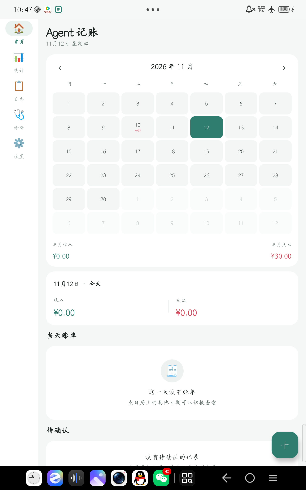
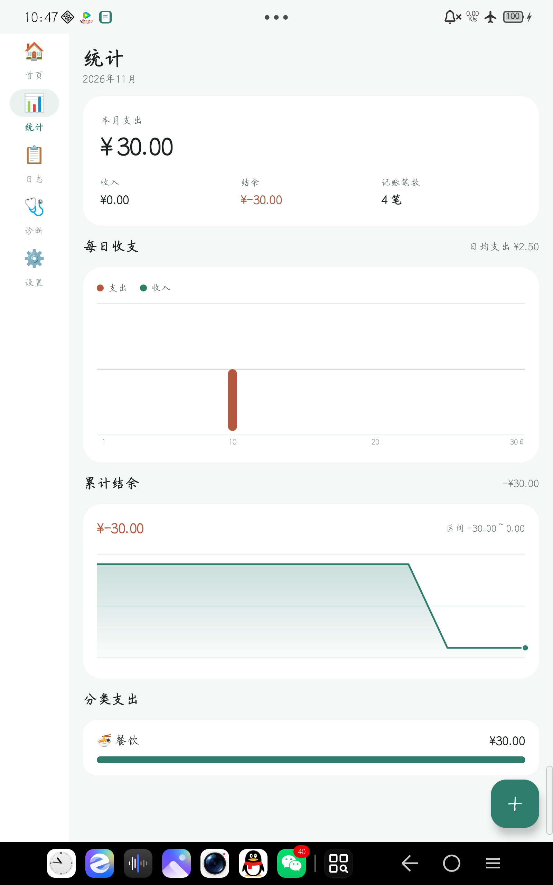
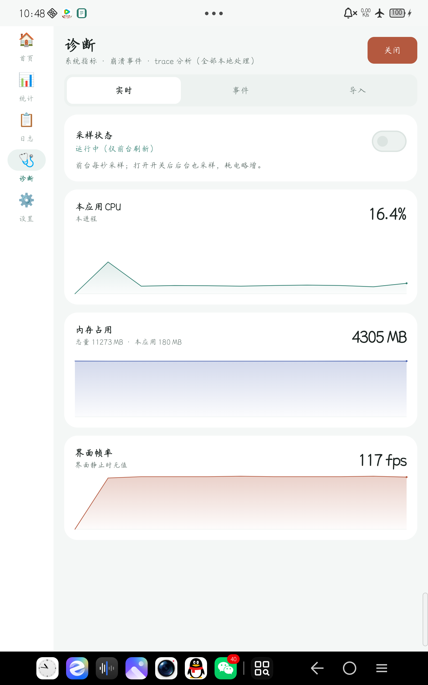
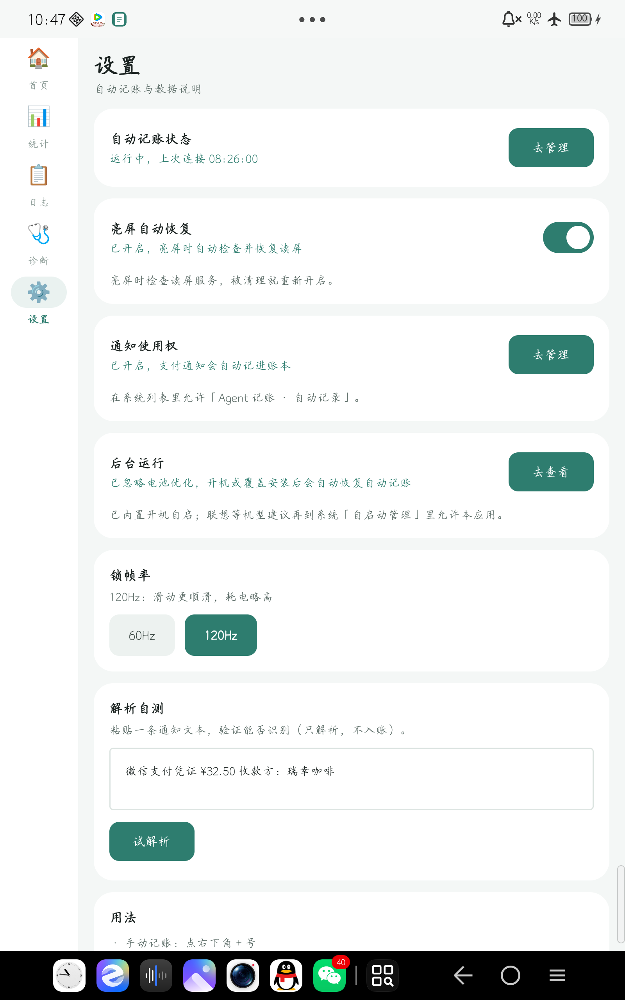

# Agent 记账 📒

> 一个跑在 Android 上的全自动记账应用。微信 / 支付宝账单自动识别、自动入账、自动分类，
> 你只管花钱，账我帮你记。

## 截图

> 下面的占位图请在真机上截取后替换，保存到 `docs/screenshots/` 目录下。
> 建议各截一张：首页月历、统计页、诊断面板、设置页。

| 首页月历 | 统计页 |
|---|---|
|  |  |

| 诊断面板 | 设置页 |
|---|---|
|  |  |

## ✨ 特性

- **三链路自动采集**：通知监听（最快、最准）+ 无障碍读屏 + ML Kit 中文 OCR 兜底
- **防错账机制**：金额 + 方向 + 商户 + 时间桶 生成去重指纹，置信度低的记录自动拦到待确认队列
- **待确认红点角标**：首页导航图标右上角实时显示未处理的记录数
- **月历 + 当天明细**：24 页滑月历（2026–2027），格子内直接标注当日收支，点哪看哪
- **秒级翻页**：42 格日格由单 Canvas + 原生 TextPaint 一次性绘制，`dumpsys gfxinfo` 量化 Janky 帧 5.5% → 1.9%
- **Room + Flow 响应式**：联合索引命中主查询，5 路数据流 combine 聚合驱动界面实时刷新
- **60 / 120Hz 可切换**：仅影响本应用窗口的锁帧率，系统其他 App 不受影响
- **手机 / 平板自适应**：NavigationBar 在手机、NavigationRail 在大屏，一套代码两种形态
- **内置诊断面板**：CPU / 内存 / 帧率实时曲线，一键关闭时全部采样停止

## 🏗️ 架构

```
                              ┌──────────────────────┐
                              │    ShareActivity     │
                              │ (长按账单 → 分享入口) │
                              └──────────┬───────────┘
                                         │
 ┌─────────────────────────────────────────────────────────────┐
 │                     UI Layer (Compose)                      │
 │  HomeScreen · StatsScreen · LogScreen · Diagnostics · ...   │
 └──────────────────────┬──────────────────────────────────────┘
                        │ StateFlow / State
 ┌──────────────────────▼──────────────────────────────────────┐
 │                ViewModel (LedgerViewModel)                   │
 │  combine(5 flows) → homeFlow → state                        │
 └──────────────────────┬──────────────────────────────────────┘
                        │ Flow
 ┌──────────────────────▼──────────────────────────────────────┐
 │  Repository ───── Room DAO (联合索引 status+time / amt+time)  │
 │                                  ↑                           │
 │  NotificationListenerService     │    ScreenReaderService     │
 │  (parse → fingerprint → enqueue) │  (OCR fallback 离线识别)   │
 │                                  │                           │
 │  BootReceiver → KeepAliveService ─┘ (开机自启保活)           │
 └─────────────────────────────────────────────────────────────┘
```

**采集链路说明**（三条独立并行，任一命中即入账）：
1. **NotificationListenerService**：系统把微信 / 支付宝的支付通知直接派发过来，文本解析后用指纹去重，最稳。
2. **AccessibilityService + ML Kit OCR**：微信自绘界面读不到节点文本时，截当前屏走本地 OCR（模型打包在 APK 里，全程离线，不点击、不上传）。
3. **ShareActivity 兜底**：支付宝账单页长按 → 分享 → Agent 记账，手动入口，解析 `Intent.EXTRA_TEXT`。

**指纹去重**：`sha1(amount + direction + merchant + 时间桶)`，同金额同商户在 ±3 分钟内视为同一笔，避免通知、OCR、分享三条链路重复入账。

## 🛠 技术栈

| 领域 | 选型 |
|---|---|
| 语言 | Kotlin 2.0.10 |
| UI | Jetpack Compose BOM `2024.06.00` · Material3 |
| 持久化 | Room 2.6.1 (KSP) · Flow |
| 后台 | NotificationListenerService · AccessibilityService |
| OCR | ML Kit Text Recognition Chinese `16.0.1`（bundled，离线） |
| 并发 | Kotlin Coroutines · Flow |
| 构建 | AGP 8.5.2 · Gradle KTS · version catalog |
| SDK | min 26 · compile / target 34 · JDK 17 |

## 📦 构建

```bash
# 克隆
git clone https://github.com/<your-username>/SmartLedger.git
cd SmartLedger

# 首次构建会自动下载 Gradle Wrapper 和依赖
# Windows
.\gradlew.bat assembleDebug
# macOS / Linux
./gradlew assembleDebug

# 产物位置
# app/build/outputs/apk/debug/app-debug.apk
```

**前置条件**：
- JDK 17+
- Android Studio Hedgehog / Iguana（或更高）
- Android SDK Platform 34

**安装到设备**：
```bash
adb install -r app/build/outputs/apk/debug/app-debug.apk
```

## 🔐 权限清单

| 权限 | 用途 | 获取方式 |
|---|---|---|
| `POST_NOTIFICATIONS` | Android 13+ 前台服务通知 | 运行时弹窗 |
| `RECEIVE_BOOT_COMPLETED` | 开机自启常驻服务 | 自动授予 |
| `REQUEST_IGNORE_BATTERY_OPTIMIZATIONS` | 减少被系统后台清理 | 设置页手动 |
| `BIND_NOTIFICATION_LISTENER_SERVICE` | 通知监听核心能力 | 设置页手动开启 |
| `BIND_ACCESSIBILITY_SERVICE` | 无障碍读屏核心能力 | 设置页手动开启 |
| `WRITE_SECURE_SETTINGS` | 读屏被关后自动恢复 | **ADB 一次性**（系统签名权限） |
| `DUMP` / `READ_LOGS` / `PACKAGE_USAGE_STATS` | 诊断面板读系统日志 | **ADB 一次性**（development 权限） |

ADB 授予一次性权限（调试用，生产构建通常移除）：
```bash
adb shell pm grant com.example.smartledger android.permission.WRITE_SECURE_SETTINGS
adb shell pm grant com.example.smartledger android.permission.DUMP
adb shell pm grant com.example.smartledger android.permission.READ_LOGS
adb shell pm grant com.example.smartledger android.permission.PACKAGE_USAGE_STATS
```

## 🧩 目录结构

```
SmartLedger/
├── app/src/main/
│   ├── java/com/example/smartledger/
│   │   ├── MainActivity.kt             # 入口 Activity
│   │   ├── SmartLedgerApp.kt           # Application（Room / Worker 初始化）
│   │   ├── ShareActivity.kt            # 分享入口
│   │   ├── data/                       # Room Entity · DAO · Repository · Migration
│   │   ├── service/                    # 通知监听 · 读屏 · 保活 · 开机自启
│   │   ├── parser/                     # 通知文本解析 + OCR 后处理
│   │   ├── util/                       # Format · FrameRateControl · DiagnosticsMonitor
│   │   └── ui/                         # Compose 界面 + ViewModel
│   ├── res/
│   └── AndroidManifest.xml
├── app/schemas/                        # Room schema 导出（纳入版本控制，用于写 Migration）
├── docs/screenshots/                   # README 用的截图（运行时放进来）
├── gradle/libs.versions.toml           # Version catalog
└── gradle/wrapper/
```

## 🔧 Release 构建与混淆

`build.gradle.kts` 里 `release` 构建类型 `isMinifyEnabled = false`，**故意未开启 R8 混淆**，原因：
- ML Kit OCR 的 bundled model 文件路径在混淆后可能被重命名，运行时找不到。
- 当前未配置完整的 ProGuard keep 规则，贸然开启会导致运行时崩溃。

等 OCR 路径问题解决后，建议开启混淆并补充 `proguard-rules.pro` 中的 keep 规则。

## 🗺️ 路线图

- [ ] 统计页趋势图（月度支出 / 收入柱状）
- [ ] 规则引擎：按商户自动分类（正则 / 关键词）
- [ ] 云同步（WebDAV / 自建 HTTP）
- [ ] 导入 CSV（支付宝账单导出）

## 🤝 贡献

欢迎提 PR 和 Issue。开发环境配置见 `CONTRIBUTING.md`。

## 📄 许可

MIT License — 见 `LICENSE`。
